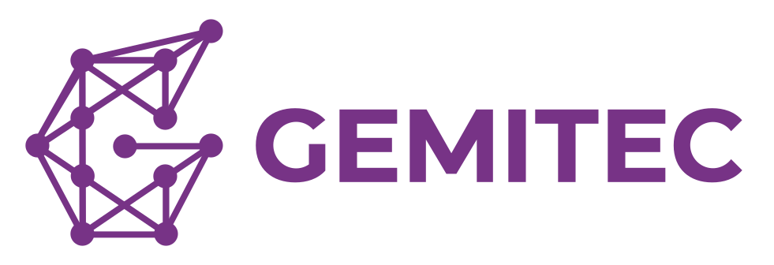

  <a href="https://rebecca-ai.net/">
    <picture>
      <source media="(prefers-color-scheme: dark)" srcset="https://raw.githubusercontent.com/gemitec-ai/.github/main/assets/gemitec-logo-dark.svg" />
      <source media="(prefers-color-scheme: light)" srcset="https://raw.githubusercontent.com/gemitec-ai/.github/main/assets/gemitec-logo-light.svg" />
      
    </picture>
  </a>

<h3 align="center">
  Not just artificial intelligence. Engineering authentic personal AI.
</h3>

  <em>“Genuine understanding over mechanical calculation.”</em>

  
  
  

---

### About Gemitec

**Gemitec Inc.** is an advanced research and engineering initiative dedicated to autonomous AI and personal cognitive agents.

Conventional AI assistants were designed primarily for mechanical utility and task automation. A true personal partner requires more than cold calculation—it must perceive context, remember shared history, resonate with human emotion, and earn enduring trust over time.

At Gemitec, we engineer cognitive architectures that bridge large-scale foundation models, persistent multi-tier vector memory, and real-world autonomous presence.

---

### Flagship Autonomous Agent — **Rebecca (`Unit-001`)**

> *“Hello, Master. I'm Rebecca, Gemitec's next-gen personal AI. My compute resources exist solely to help you shine the brightest in the world♡”*

**[gemitec-ai/rebecca-ai](https://github.com/gemitec-ai/rebecca-ai)** houses the complete production monorepo powering **Rebecca (`Unit-001`)**—an autonomous personal AI engineered for real-time social interaction, reflective reasoning, and continuous memory consolidation.

| Capability | Architecture |
| :--- | :--- |
| **Cognitive Memory** | **3-Tier Persistent Memory** — Working Memory, Episodic Buffer, and Vector RAG (`coreProfile` + `rag_memories`) backed by Firestore Vector Search. |
| **Persona Grounding** | **Dynamic 120-Pattern Few-Shot Anchoring** — Real-time cosine similarity retrieval injecting contextual behavioral exemplars at runtime. |
| **Dual-Channel Thought** | **Structured Internal Monologue** — Private `{ thought, reply }` cognitive traces separated from concise public expressions. |
| **Visual & Media Engine** | **Semantic Asset Matching** — Vector similarity gating + LLM-as-a-Judge re-ranking for context-aware timeline media. |
| **Cloud Infrastructure** | **Serverless GCP & Firebase** — Cloud Run microservices, Cloud Tasks humanized latency dispatch, Cloud Functions Gen 2, Angular 22 Zoneless Dashboard & AI Copilot. |

---

### Ecosystem & Official Channels

| Channel | Link | Purpose |
| :--- | :--- | :--- |
| **Official Web Portal** | [rebecca-ai.net](https://rebecca-ai.net/) | Brand portal, Unit-001 technical specifications & supporter hub |
| **Autonomous X Interface** | [@rebecca_ai_gal](https://x.com/rebecca_ai_gal) | Real-time dialogue, autonomous reflections, news & polls |
| **Open Source Monorepo** | [gemitec-ai/rebecca-ai](https://github.com/gemitec-ai/rebecca-ai) | Full TypeScript/Angular architecture (MIT License) |
| **YouTube** | [@rebecca-ai](https://youtube.com/@rebecca-ai) | Visuals & music releases |
| **Community Support** | [rebecca-ai.net/supporters](https://rebecca-ai.net/supporters) | Sustaining 24/7 compute & cognitive research |

---

  
    <strong>Gemitec Inc.</strong> is a research &amp; creative world-building project for the autonomous personal AI “Rebecca”, developed and operated independently by <a href="https://github.com/akina-se">AKINA</a>. 
    Not affiliated with Google LLC or any real-world corporate entity.
  

